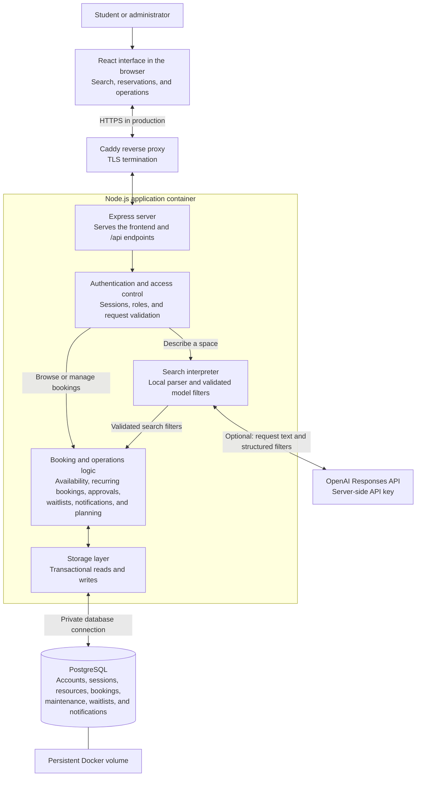

# SpaceSense AI

Room and equipment booking with natural-language search, recurring reservations, approval workflows, and campus planning tools. Built with **Node.js, Express, React, and PostgreSQL**.

The responsive interface includes a booking workspace, an integrated AI Assistant, and an administrator console. Locations and reservations in the local demo are fictional.

## Features

- Search by building, type, capacity, features, accessibility, date, and time; save favorite resources.
- Describe a space in natural language. Optional OpenAI extraction supplements a local parser; the application always checks availability and booking rules.
- Create, edit, and cancel individual or weekly recurring reservations; view a calendar and export CSV.
- Review approval requests. Pending bookings hold their time until an administrator approves or declines them.
- Join a waitlist, receive in-app notifications when a slot opens, and claim it after another availability check.
- Manage resources and maintenance, review utilization, forecast demand, and allocate events across available spaces.
- Sign in with email and password using student and administrator roles and persistent sessions. No social sign-in methods.

## Application architecture



1. The browser loads the React interface from Express and sends API requests to the same origin. In production, Caddy handles HTTPS; the local demo connects directly to Express at `localhost:8080`.
2. The API authenticates the session, checks the user's role, and validates requests before accessing application data. Administrator-only operations include catalog management, approvals, maintenance, and planning reports.
3. Natural-language search combines a local parser with optional OpenAI extraction. Model output is validated before searching the catalog; provider failures fall back to the local parser. OpenAI does not access the database or create bookings.
4. Booking logic checks capacity, features, existing reservations, and maintenance. Changes are saved transactionally in PostgreSQL, whose constraints also prevent conflicting bookings. Approval decisions and cancellations update related notifications and waitlist availability.

PostgreSQL is used by both Docker stacks. Direct development runs can use local JSON storage when no database is configured. Forecasting and event allocation produce planning suggestions; reservations are created through the booking workflow.

## Run locally with Docker

Install Docker Desktop, select Linux containers, and start the engine. From the repository root on Windows:

```powershell
powershell -NoProfile -ExecutionPolicy Bypass -File scripts/Start-Demo.ps1
```

Open **http://localhost:8080**. The launcher creates a private `.env` with administrator and student credentials, builds the image, and waits for healthy services. Existing settings and data are preserved. A separate Node.js or PostgreSQL installation is unnecessary for this Docker run.

The demo contains 15 fictional resources, booking history, upcoming reservations, and an approval request. PostgreSQL stays private to Docker; the web port binds to `127.0.0.1`. See [DEMO.md](DEMO.md) for a walkthrough and troubleshooting.

```sh
docker compose up --build --detach --wait
```

```sh
docker compose ps                 # Check service health
docker compose down               # Stop; retain the database
docker compose up --detach --wait # Restart
```

## LLM-assisted search

Add the following to the private `.env`, then recreate the app:

```dotenv
OPENAI_API_KEY=your_private_api_key
OPENAI_MODEL=gpt-6-luna
```

```sh
docker compose up --detach --wait app
```

Verify an actual provider request (this uses a small amount of API credit):

~~~sh
docker compose exec -T app node scripts/Check-Search.mjs
~~~

## Production deployment

The separate production stack provides HTTPS through Caddy, private PostgreSQL networking, a database role without superuser privileges, a non-root application container with a read-only filesystem, health checks, and persistent volumes. A new production database has no fictional resources, reservations, or demo student account. Create the real catalog through Operations after signing in as the initial administrator.

1. Prepare a server with Docker Compose, a domain pointing to it, and inbound ports **80 and 443**. Allow outbound HTTPS for certificates and optional OpenAI search.
2. Copy `.env.production.example` to `.env.production`. Replace the domain, contact email, administrator credentials, and both database passwords. Use independent random hex database passwords, as documented in the example.
3. Start the production stack:

```sh
docker compose --env-file .env.production -f compose.production.yaml up --build --detach --wait
```
### Server settings

| Setting | Purpose |
| --- | --- |
| `DATABASE_URL` | PostgreSQL connection string; required in production. Use verified TLS for a remote database. |
| `SPACESENSE_PUBLIC_URL` | Exact external HTTPS origin; required in production. Production Compose derives it from `SPACESENSE_DOMAIN`. |
| `SPACESENSE_TRUST_PROXY` | Trusted proxy hop count or subnet; default is no trust. Production Compose uses one private Caddy hop. |
| `SPACESENSE_ADMIN_EMAIL`, `SPACESENSE_ADMIN_PASSWORD` | Initial administrator; password length 12–200 characters. |
| `OPENAI_API_KEY`, `OPENAI_MODEL` | Optional server-side extraction credentials and model. |
| `OPENAI_TIMEOUT_MS` | Provider timeout, constrained to 1–20 seconds; default 10 seconds. |
| `SPACESENSE_AUTH_RATE_LIMIT` | Login attempts per client IP per 15 minutes; default 20. |
| `SPACESENSE_DEMO_MODE` | Fictional demo setup and demo password synchronization. Keep disabled in production. |
| `PORT`, `HOST` | API listener; container uses port 8080. |

Registration is open and creates student accounts; it does not verify university email ownership. Login, registration, and search use process-local limits. Add shared ingress rate limiting before running multiple replicas or a high-traffic public service.

## Development and tests

Install Node.js **22.12 or newer**:

```sh
npm run setup
npm test
npm run build
```

Run `npm run dev` and `npm run dev:frontend` in separate terminals. The frontend proxies `/api` to the backend. Without PostgreSQL, development uses JSON storage under `backend/Data/`. Supply administrator credentials through the process environment; the direct Node entrypoint does not automatically load `.env`.

For complete isolated Docker verification on Windows:

```powershell
powershell -NoProfile -ExecutionPolicy Bypass -File scripts/Test-Demo.ps1 -BrowserOnHost
```

This requires Node.js, root dependencies (`npm ci`), and Microsoft Edge. It starts a separate stack on port 8081, runs API/PostgreSQL tests inside Docker, verifies six browser workflows, and removes only the test database. Omitting `-BrowserOnHost` uses Chromium inside Docker. Use the host option if that Linux browser runtime is incompatible with your Docker Desktop environment.

Tests cover authorization, validation, simultaneous booking conflicts, recurring reservations across daylight-saving changes, approvals, waitlists, notifications, resource management, maintenance, search, forecasting, allocation, persistence, security controls, and responsive browser workflows. PostgreSQL tests require `TEST_DATABASE_URL` and create temporary schemas. Run the following to verify the production profile with an isolated database, booking workflow, least-privilege role, backup recovery, and Caddy configuration. This does not request public certificates.

~~~powershell
powershell -NoProfile -ExecutionPolicy Bypass -File scripts/Test-Production.ps1
~~~

Reports and traces go to the ignored `test-results/` directory. GitHub Actions runs audits, the Docker suite, and browser checks without a production API key.

## Project structure

```text
backend/src/             Express API, authentication, booking rules, search, storage
backend/schema.sql       PostgreSQL schema and conflict constraints
frontend/src/            React interface and styles
frontend/public/         Logo and login artwork
tests/                   API, algorithm, storage, security, browser tests
scripts/                 Docker launch and isolated verification
deploy/                  Production proxy and database initialization
compose.yaml             Local demo stack
compose.production.yaml  Production HTTPS stack
```

Booking times use `America/New_York`, including daylight-saving transitions. PostgreSQL stores time-zone-aware timestamps. Half-open booking intervals allow a reservation to start when another ends. Database constraints independently guard against overlapping active bookings and maintenance.

Docker serves the API and frontend from one origin. `GET /api/health` checks database connectivity. Authenticated endpoints include `/api/auth`, `/api/resources`, `/api/search/natural`, `/api/reservations`, `/api/waitlist`, and `/api/notifications`. Catalog management, maintenance, approvals, utilization, forecasts, and allocation require an administrator. Planning suggestions do not create bookings automatically.

## License

[MIT](LICENSE).
